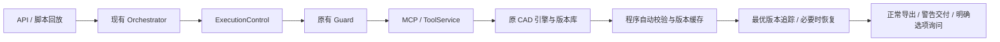

# 智绘CAD Milestone 1：代码勘察与验收报告

日期：2026-10-18。交付范围：真实案例回放 + 共享执行控制中间件，接入现有 single 模式。

## 验收结果

- 原包基线：18 个原有测试文件，128 个测试全部通过，耗时 121.20 s。
- 修改后全量门禁：**169 passed**，耗时 141.16s (0:02:21)。
- 原有 22 个脚本基准与新增 S001～S005：**27/27 通过**。
- 五个真实案例全部结束于交付或明确选项询问；没有 FAILED，没有超过 40 次实际工具调用。
- 原有 18 个测试文件逐字节未改；`zhihui/cad/` 全部原有引擎文件、`guards.py` 逐字节未改。
- 原数据库只读提取，提取前后 SHA-256 相同：`0b387f6a26aa924663426a13d8bc6d158b6770336aaedc413aa47fb2df3b3182`。

## 现有源码结构与问题定位

已检查用户要求的 orchestrator.py、llm.py、prompts.py、guards.py、MCP server.py、tools/core.py、api/app.py、前端 app.js 和 bench/run.py，并核查 DrawingStore、数据库与相关测试。

`Orchestrator` 原来直接向模型开放全部工具；校验、修复、导出均混在同一循环里。总调用计数只计算模型请求，程序校验与导出未计入；先加到 41 再判失败。失败签名没有记忆，空查询会被视为成功调用。模型完成后才强制审图，两轮修复后统一 FAILED。

`ToolService` 的事务、图纸版本存储、确定性布局和规范检查可以继续复用。工具失败不会提交半成品。`DrawingStore` 已具备 JSON 历史快照，但原先没有恢复接口。API 通过事件写入 SQLite，前端轮询展示结果。SQLite status 是 TEXT，因此新增交付状态无需破坏性迁移。



## 真实数据来源与回放口径

数据库原路径：`C:\Users\Administrator\Documents\Codex\2026-10-14\2025-2026-cad-llm-2025-2026\outputs\CAD_LLM_2025_2026文献\cad-main\-CAD-main\data\zhihui.db`。共 38 个任务：33 READY、3 FAILED、2 WAITING_CONFIRMATION。S004、S005 原始终态已是等待确认；它们是操作与知识问题案例，不能把五例全部称作原始 FAILED。

S001：真实事件为 1 次读取 + 39 次 find_entities。当前在第一次盲搜前识别标题栏能力缺口，提供确认选项。

S002：真实事件为 36 次 add_hatch（包含不同填充动作）。当前对失败签名、同一目标继续猜拾取点分别拦截，使用现有图纸警告交付。命名区域填充工具属于 M2，当前没有宣称该功能已完成。

S003：真实事件含 12 次 validate_drawing、18 次 move_equipment。当前撤销模型校验权限，自动按 revision 校验；三次无改进修改或 A→B→A 触发冻结与程序布局。问题分升高时恢复最优快照。自环会在调用引擎前拒绝并询问边界物料表达。

S004：真实任务曾构建 19 台设备后因压盖询问用户。当前对缺少确认清单与知识来源的菜市场/小型餐饮工艺，在绘图前询问，避免重放无依据设备清单。八类知识模板与完整方案确认归 M3/M4。

S005：原任务的事件跨多次用户续接，保留 41 条工具事件，但 result.usage 只记录最后一次执行的 2 次调用。原始事件与最终统计分别保存，不能相加或当作一次运行。回放不自动授予历史整图重排权限，因此在原件读取后明确询问；删除和编辑标注归 M2。

每个 S*.json 分开存储 historical_events（原始 payload）、historical_result、归一化 steps 和 source。源库只记录参数与摘要的地方，没有补造完整工具返回值。原始输入 DXF 已复制至 cases/replay_inputs，逐件保存 SHA-256，运行时再创建工作副本。回放是历史调用序列的 Scripted Mock 执行，不等于重新调用当时的线上模型。

| 回放 | 真实任务 | 历史事件中的工具调用 | 本次实际 MCP 调用 | 本次终态 | 耗时 |
|---|---|---:|---:|---|---:|
| S001 | `t_df0ba4f400b9` | 40 | 2 | `WAITING_CONFIRMATION` | 1.909 s |
| S002 | `t_75d12c62024e` | 40 | 15 | `READY_WITH_WARNINGS` | 4.359 s |
| S003 | `t_ca2a940e939c` | 40 | 18 | `READY_WITH_WARNINGS` | 4.296 s |
| S004 | `t_6b3dfab9d882` | 22 | 0 | `WAITING_CONFIRMATION` | 0.006 s |
| S005 | `t_4cde7bbe4e6a` | 41 | 2 | `WAITING_CONFIRMATION` | 0.138 s |

## M1 已落实的执行控制

1. 规范化签名：键排序、数值保留一位小数，失败后再次提交相同签名直接拒绝；同一问题累计两次拦截升级。
2. JSON 错误手册：最大次数、按顺序的动作、升级目标；边界填充失败后禁止通过换拾取点绕过拦截。
3. 有限升级：程序布局最多一次，再询问明确选项或带警告交付；不会继续盲试。
4. 几何振荡：A→B→A 冻结相关对象；三次修改分数不降触发布局恢复；分数上升立即恢复最优快照。
5. 合规图幅：从原有 PAPER_SIZES 与规范允许的加长幅面枚举，在图纸副本上试算尺寸；不会生成 A1x3 等无效名称。超过能力时询问分张方案。
6. 自动审图：模型看不到 validate_drawing/export_artifacts，也看不到恢复版本/内部快照参数；每次 revision 改变自动校验，同一版本复用结果。引擎既有 standards_check 仍必跑。
7. 无进展熔断：默认连续 6 次无 revision 进展触发；可通过 ZHIHUI_STALL_CALLS 配置。空查询同样计入失败记忆。
8. 最优版本：error×10 + warning×1，只对已布局且拓扑可用的图纸记录；恢复时生成更大的新 revision，不覆盖历史文件。恢复走既有 MCP inspect_drawing 的受控扩展，支持远端部署。
9. 警告交付：只允许存在基础可用版本时导出；未布局、设备自环、断开的拓扑等不能绕过。DXF/PNG/PDF 的主图含可见说明，并附逐项未解决事项 Markdown。API 持久化、终态判断、下载与前端停止轮询/橙色状态已打通。

全部真实 MCP 调用（包括程序校验、恢复、布局、导出）计入 40 次预算；拦截请求不执行工具，单独计入拦截统计。程序预留交付调用与时间。各阶段预算配置接口已保留，M4 状态机将使用该配置；M1 不宣称已经实现多角色阶段调度。

## 测试与复现

双击根目录的 `验证_M1.bat`，或者在 app 目录执行（PowerShell）：

```powershell
& '..\runtime\python\python.exe' -m zhihui.contracts
& '..\runtime\python\python.exe' -m pytest -q -p no:cacheprovider
& '..\runtime\python\python.exe' -m zhihui.agent.replay run --mock
& '..\runtime\python\python.exe' -m zhihui.bench.run --llm scripted
```

只读重新导出：

```powershell
& '..\runtime\python\python.exe' -m zhihui.agent.replay export --db '实际 data\zhihui.db 路径' --output '导出目录'
```

新增测试覆盖：签名/拾取点绕过、错误动作次序、端口限次、自环拦截、能力缺口、振荡与冻结、无进展、分数与恢复、版本历史、图幅副本试算、缓存、模型权限、警告水印、未布局拒绝导出、模型断线与预算、五例真日志回放、只读导出、API 下载与确认后恢复。

验证使用包内 Python 3.13 与原有离线依赖，不需要任何外部 API Key。没有调用真实 DeepSeek/Qwen；这些结果仅证明本地引擎、执行控制和历史脚本回放，不能当作真实模型成功率或完整 multi 架构性能对比。

## 后续里程碑状态

M1 通过本次门禁。M2（标题栏、命名区域填充、标注编辑删除）、M3（完整知识库与缺口落库/CLI）、M4（ProcessSpec/黑板/多角色状态机）、M5（完整方案卡片与知识看板）、M6（single/multi 真实模型对比与最终离线发行）尚未计为完成。

M1 为避免新状态导致前端无限轮询，已提前加入警告终态的最小全栈支持；这不等于完成 M5。结构性差异见 `变更与来源校验.json` 和单独的源码 patch；原压缩包与原项目未被覆盖。
