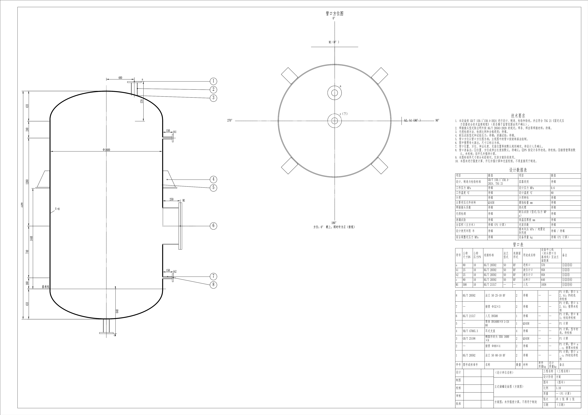
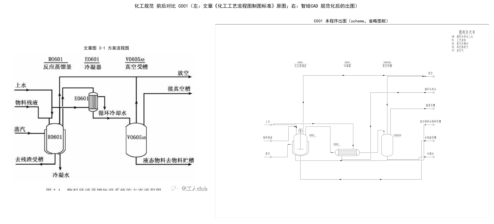
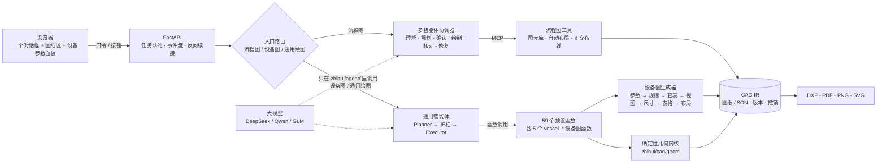
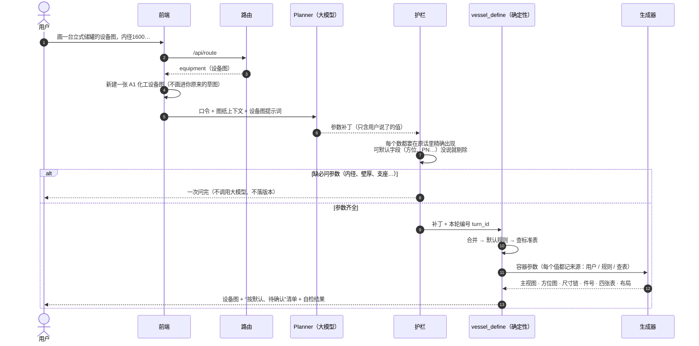
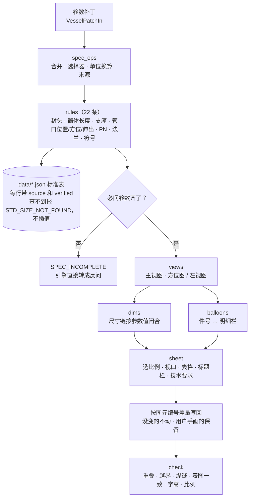

# 智绘CAD · 化工设计绘图

> 一句话画化工图：**工艺流程图、化工设备图、通用二维 / 三维 CAD**，都在同一个对话框里完成。
> 大模型只负责“听懂话、写参数”，**所有坐标和几何都由确定性程序计算**；缺关键参数就反问，不替你编数值。

| 指标 | 数值 |
|---|---|
| 自动化测试 | **1770** 个，全部通过 |
| 基准用例（脚本模式） | **94 / 94**（流程图 G/M/F/C/S、通用 CAD B/D/A、化工设备图 E） |
| 化工设备图 · 真实大模型（DeepSeek deepseek-flash） | 两轮都是 **12 / 12**，语音误识别写法 **12 / 12** |
| 通用 CAD · 真实大模型 | 修复前 32/50 → 修复后三轮 46、48、45/50 |

> ⚠️ 设备图输出是**方案图**：标准件尺寸按公开资料录入、**尚未与标准原文核对**；**未做强度计算、开孔补强计算和支座校核，不得直接用于制造**。导出的 DXF 只经过 ezdxf 自检，没有在 AutoCAD / 浩辰 / 中望里逐一验证。

**目录**：[能做什么](#能做什么) · [5 分钟跑起来](#5-分钟跑起来) · [架构](#架构) · [一句话是怎么变成图纸的](#一句话是怎么变成图纸的) · [设计原则](#设计原则) · [开发中的有趣发现](#开发中的有趣发现) · [参考资料](#参考资料) · [目录结构](#目录结构) · [常用命令](#常用命令) · [文档索引](#文档索引)

---

## 能做什么

### 1. 化工设备图（立式 / 卧式储罐方案图）

```text
画一台立式储罐的设备图，内径1600，筒体高2400，标准椭圆封头，壁厚8，材料Q345R，
设计压力0.6MPa，设计温度80℃，人孔DN500，进料口DN80，出料口DN80，两个液位计口DN25，四个耳式支座
```

一句话生成一张 A1 设备图：**主视图**（全剖、壁厚夸大、管口旋转画法）、**管口方位图**（卧式为左视图）、**管口表、设计数据表、明细栏、技术要求、标题栏**。接着说就能改：

`把进料口转到90度` · `筒体加长500` · `上封头再加一个DN50的放空口` · `支座改成3个` · `设计压力改成1.0MPa`（默认 PN 自动重新初选）· `出一张管口方位图` · `导出 DXF 和 PDF`

只说“画一个立式储罐”时，系统**一次问完**：要流程图还是设备图、内径、筒体长度、壁厚、支座、管口。



### 2. 工艺流程图

`画精馏工段的工艺流程图` → 规划设备与连接 → 你确认方案 → 出图（DXF / PDF / PNG）→ 继续说话改图（`把 P-101 向右移动 800`）。支持方案流程图、物料流程图、施工流程图和给水处理高程布置图。



### 3. 通用二维 / 三维 CAD

鼠标点画、敲 AutoCAD 命令（`L 0,0 @100,0`）、打字或语音口述（“画一个矩形，左下角在零零，长120宽80”）都行。46 个预置函数覆盖图层、绘图、编辑、标注、公差、块、约束、布局出图和三维建模（拉伸、旋转、布尔）。

---

## 5 分钟跑起来

**产品里没有离线版**：自然语言口令都要经过大模型（默认 DeepSeek）。没配 Key 时页面会明确提示，不会悄悄退回规则；直接输入的 AutoCAD 命令不需要大模型。

```bash
python -m venv .venv
.venv/Scripts/python -m pip install -e ".[dev]"
cp 04_后端与部署/.env.example .env            # 填 DEEPSEEK_API_KEY（也可以启动后在页面 ⚙ 设置里填）
.venv/Scripts/python -m zhihui.api             # 打开 http://127.0.0.1:8000
.venv/Scripts/python -m pytest -q              # 全量测试（ZHIHUI_LLM=mock 下不调用大模型）
```

可选依赖：任意实体的三维布尔需要 `pip install manifold3d`（`pip install -e ".[solid]"`）；不装也能跑，只是这类布尔会报 `BOOLEAN_UNSUPPORTED`。

---

## 架构



- **只有 `zhihui/agent/` 能调用大模型**；MCP 子进程和工具层里只有确定性代码（拿不到 API Key）。
- **一次成功修改只落一个版本**，所有修改可撤销 / 重做；失败的批量整体回滚。
- **CAD-IR** 是唯一的数据格式：前端、智能体、导出都读写它；DXF 里内嵌 IR，旧图能无损打开。

---

## 一句话是怎么变成图纸的



设备图生成器内部是一条纯函数流水线（`zhihui/cad/equipment/`）：



---

## 设计原则

1. **模型不算数。** 坐标、尺寸链、总高、方位换算、单位换算都由程序算；模型写 `{"value": 1.6, "unit": "m"}`，程序换算成 1600。
2. **数字要有出处。** 设备参数里每个“用户给的”数，都必须和原话里的某个数精确相等，不放行倍数、不用常量表。
3. **缺了就问，一次问完。** 必问参数缺失时由代码拼出问题（带推荐选项），不消耗模型调用。
4. **默认值要说出来。** 规则补的值在回复、管口表备注和技术要求里都标“按默认，待确认”；PN、法兰型式、支座型号只在设计条件齐全时“初选”。
5. **参数是唯一真源。** 改设备一律改参数再重新生成；手动改了生成的图元，它会“脱离参数”，以后不再被覆盖。
6. **不装作已校核。** 未核对的数据、未做的计算，图上和回复里都写明。

---

## 开发中的有趣发现

真实使用和写测试的过程中挖出来、并已修复（大多带回归测试）的问题：

| 发现 | 后果 | 怎么解决的 |
|---|---|---|
| **路由把“储罐、精馏、换热”当成流程图信号** | 画设备图的成功率是 **0**：“立式储罐设备图…”被画成一张标题为“精馏”的流程图，每个管口被当成一台设备 | 路由改成三分（流程图 / 设备图 / 通用），图种词和结构词优先，加了 41 条反例测试 |
| **“固定管板”命中“约束”类，“20块塔板”命中“块”类** | 工具子集选错，模型只能编函数名 | 关键词加边界规则 |
| **按关键词只给模型 1–3 类函数** | 通用 CAD 真实模型只有 **32/50** | 模型要的函数不在子集里就换全量目录重来；声明的类别超出子集就放宽 → **46–48/50** |
| **旧数值护栏“对的拦、错的放”** | 编出来的方位 180°、径向 800（=1600/2）、PN16（=8×2）、直边 25（借自 DN25）都能通过，合理的“内径1.6米→1600”反而被拦 | 设备参数专用护栏：精确相等、不放倍数；可默认字段要在“触发词所在分句”里才放行 |
| **“600千帕”被规范化成“6000帕”** | 错的数还会被护栏当成用户给的放行 | 阿拉伯数字后的“千/百/万”保持原样 |
| **超过 10 条的 few-shot 模型根本看不到** | `few_shot_text(n=10)` 只取前 10 条，新增示例形同虚设 | 设备图示例单独成组，只在需要时拼入 |
| **工具目录里嵌套参数显示成“对象”** | 模型猜字段名，动态块、标准件反复参数错误 | 目录展开嵌套字段；但设备参数**故意不展开**（展开就等于引导模型去填默认字段） |
| **管口符号要“左下起顺时针”编号** | 规则表里符号排第一，但它依赖管口位置 | 符号规则挪到最后执行，分配后保持稳定，加删管口不重排 |
| **壁厚 8 mm 在 1:10 图上只有 0.8 mm** | 线挤在一起；按图测尺寸又会偏大 | 图上壁厚夸大到 1 mm，**尺寸定义点取参数真值**，所以尺寸文字永远等于参数 |
| **DXF 文字不继承样式的宽度因子** | 长仿宋 0.7 只在样式里设置时，AutoCAD 照 1.0 显示，汉字表格溢出 | 设备图文字单独写宽度因子 |
| **一对液位计口在俯视图里完全重合** | 自检报“重复图元” | 同方位、同伸出、同法兰的管口只画一次，标签合并成“b1、b2（90°）” |
| **基准检查器看不到批量里的函数** | 真实模型把函数放进 `cad_batch_execute` 时被误判失败 | 计划事件带参数，检查器能看到批量内部 |
| **`robocopy /XD data` 会排除所有叫 data 的目录** | 部署时把 `zhihui/cad/equipment/data`（标准表）也漏了，线上第一次出图直接报错 | 排除写完整路径，部署后核对 |
| **多代理并行开发会被会话额度打断，而且不交报告** | 改动落了盘、却没有说明 | 主会话逐个检查代码、补缺失的测试、全量回归；“没有报告 ≠ 通过” |

---

## 参考资料

### 论文（开发前调研阅读的 25 篇）

这些论文用于理解“大模型 + CAD”的研究现状和评测方法。**本项目没有复现其中的模型**：它们大多做 B-rep / CAD 程序的生成与表示学习，而本项目选择了“大模型写参数、确定性程序出图”的工程路线，主要借鉴了其中的交互式编辑、验证与评测思路。

| 方向 | 论文 |
|---|---|
| LLM 生成 CAD 代码与交互编辑 | [IterCAD](https://arxiv.org/abs/2606.13368v2) · [ProCAD](https://arxiv.org/abs/2602.03045) · [CADEvolve](https://arxiv.org/abs/2602.16317v1) · [CADENA](https://arxiv.org/abs/2608.00799) · [CAD-Coder](https://arxiv.org/abs/2505.19713v3) · [STEP-LLM](https://arxiv.org/abs/2601.12641) · [B-repLer](https://arxiv.org/abs/2508.10201) |
| 基准测试 | [Text2CAD-Bench](https://arxiv.org/abs/2605.18430v1) · [BenchCAD](https://arxiv.org/abs/2605.10865) · [CADBench](https://arxiv.org/abs/2605.10873v2) · [MUSE](https://arxiv.org/abs/2605.28579) |
| CAD 分词与多模态表示 | [BRepCLIP](https://arxiv.org/abs/2606.05515v1) · [BRT](https://arxiv.org/abs/2504.07134) · [BrepARG](https://openaccess.thecvf.com/content/CVPR2026/papers/Li_AutoRegressive_Generation_with_B-rep_Holistic_Token_Sequence_Representation_CVPR_2026_paper.pdf) · [CAD-Tokenizer](https://arxiv.org/abs/2509.21150) |
| B-rep 生成与修复 | [HiFi-BRep](https://arxiv.org/abs/2608.16485) · [Towards Valid B-Rep Generation](https://arxiv.org/abs/2608.04955) · [BrepGPT](https://arxiv.org/abs/2511.22171) · [BrepForge](https://arxiv.org/abs/2605.19411) · [DualBrep](https://arxiv.org/abs/2606.31579) · [HoLa](https://arxiv.org/abs/2504.14257) · [ParaCAD](https://arxiv.org/abs/2607.17093) |
| 自监督表示学习 | [Masked Topology Modeling](https://arxiv.org/abs/2607.20642) · [BRepMAE](https://arxiv.org/abs/2602.22701) · [Masked BRep Autoencoder](https://arxiv.org/abs/2603.14927) |

检索入口：[awesome-ai4cad](https://github.com/gudo7208/awesome-ai4cad)。

### 标准与制图规范（只引用标准号，仓库里不放原文）

- 技术制图：GB/T 14689（图纸幅面）、GB/T 14690（比例）、GB/T 14691（字体）、GB/T 10609.1（标题栏）、GB/T 4457.4（图线）、GB/T 4458.2（件号）
- 化工流程图：HG/T 20519 系列
- 化工设备图：HG/T 20668（设备设计文件编制）、GB/T 150.1~4-2024（压力容器）、GB/T 25198（封头）、HG/T 20592（管法兰）、HG/T 21514~21535（人孔）、NB/T 47065.1/.3（鞍座 / 耳式支座）、NB/T 47042、HG/T 20583、TSG 21

设备图用到的每张数据表的来源和核对状态见 [数据表清单](01_项目文档/化工设备图_数据表清单.md)（目前全部 `verified: false`）。

---

## 目录结构

Python 代码都在 `zhihui/` 包里；带编号的中文目录放文档、用例和前端。

```text
zhihui/
├── agent/          # 只有这里调用大模型：路由、Planner、护栏、提示词、流程图多智能体
├── api/            # FastAPI：任务、图纸、路由、渲染、导出
├── cad/
│   ├── geom/       # 确定性几何内核（求交、修剪、布尔、标注、布局）
│   └── equipment/  # 化工设备图生成器 + data/ 标准表
├── tools/general/  # 通用 CAD 与设备图的预置函数（registry 注册）
├── ir/             # CAD-IR 数据模型（含 vessel.py）
├── mcp_server/     # MCP Server
└── bench/          # 基准评测
01_项目文档/        # 设计说明、功能对照表、接口约定、变更总结
05_前端/web/        # 单页前端（cad.html / cad.js）
06_测试与基准用例/  # 基准用例 G/M/F/C/S/B/D/A/E
tests/              # pytest
```

## 常用命令

| 做什么 | 命令 |
|---|---|
| 全部基准（脚本模式，不调大模型） | `.venv/Scripts/python -m zhihui.bench.run` |
| 化工设备图基准（真实模型，只跑口令写法） | `.venv/Scripts/python -m zhihui.bench.run --llm real --no-asr --category E` |
| 通用 CAD 基准（离线规则 Planner） | `.venv/Scripts/python -m zhihui.bench.run --llm mock --category BDA` |
| 模型选型 | `.venv/Scripts/python -m zhihui.bench.run --llm real --provider deepseek` |
| 启动 MCP Server（stdio / 内网 HTTP） | `.venv/Scripts/python -m zhihui.mcp_server` / `ZHIHUI_MCP_TOKEN=xxx … --http --port 8765` |
| 重新导出接口 Schema | `.venv/Scripts/python -m zhihui.contracts` |

## 文档索引

| 主题 | 文档 |
|---|---|
| 化工设备图 | [设计说明](01_项目文档/化工设备图_设计说明.md) · [功能对照表](01_项目文档/化工设备图_功能对照表.md) · [数据表清单](01_项目文档/化工设备图_数据表清单.md) · [变更总结](01_项目文档/化工设备图_变更总结.md) · [改造任务书](01_项目文档/化工设备图能力_改造提示词_v1.md) |
| 通用 CAD | [设计说明](01_项目文档/通用CAD能力_设计说明.md) · [功能对照表](01_项目文档/通用CAD能力_功能对照表.md) · [变更总结](01_项目文档/通用CAD能力_变更总结.md) |
| 接口 | [接口约定](01_项目文档/接口约定/接口约定.md)（工具 Schema、CAD-IR Schema、错误码、Web API、基准格式） |

## 许可证

[MIT](../LICENSE)
